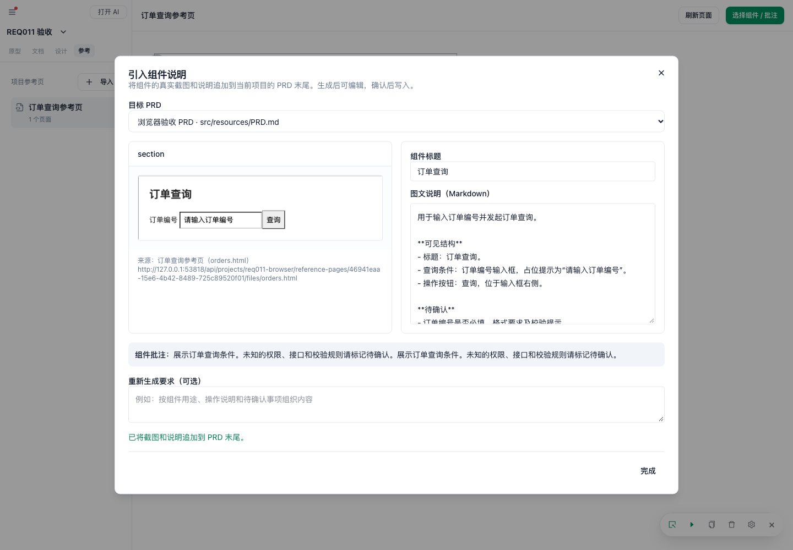
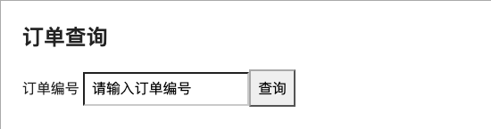

# REQ-011 开发验证与验收

日期：2026-11-06。分支：`codex/reference-component-prd`。首版已实现，待用户验收；尚未提交。

## 验收步骤

1. 双击桌面“启动 Axhub Make 开发分支.command”，打开 `http://127.0.0.1:53818`，刷新已有页面。
2. 在“设计”之后打开“参考”，导入当前页面链接、完整发布 ZIP 或单个 HTML。ZIP 可填写入口路径，也可在顶部选择具体 HTML 页面。
3. 点击“选择组件 / 批注”，选中一个组件或容器。共用现有批注输入框；文档动作允许留空，多选时“引入说明”不可用。
4. 点击“引入说明”，选择当前项目中的 Markdown PRD，手动点击“AI 生成图文”。核对真实截图、说明和“待确认”事项；可编辑标题、正文，或生成后补充重新生成要求。
5. 点击“确认追加到 PRD 末尾”。核对原文保留、图片显示、来源及组件选择器正确。同一组件再次引入仍追加，不覆盖旧内容。
6. 参考页的“AI 生成原型”会先在宿主窗口展示要求；点击“确认交给 AI”后才执行。生成内容采用线框图风格，完成后刷新参考页，再对展开后的组件生成图文。
7. 普通原型页面的单组件批注也可点击“引入说明”。取消预览不写入 PRD，AI 失败后可重试。

## 已执行的开发核验

- 45 个相关测试文件、541 项测试全部通过，覆盖新功能、批注持久化、原有选区导出及 Axure AI 整理回归。
- `pnpm admin:build`、`pnpm vendor:build:commentary` 通过；服务端 TypeScript、vendor 专项 TypeScript、启动脚本语法和 `git diff --check` 通过。
- 全量前端生产源码类型检查仍有历史错误：基线 197 项，当前 196 项；按文件及错误类别比较，没有新增错误组，新增功能文件未报错。本次没有将全量前端类型检查列为通过项。
- 独立浏览器与测试项目中完成真实截图、批注保存、实际 AI 视觉生成、手动编辑及确认追加；验证 PRD 原文未改变、编辑内容已保存、PNG 使用项目内相对路径。
- 实际 AI 从截图识别出订单查询标题、订单编号输入框与查询按钮，未提供的权限、接口和校验规则列为“待确认”。
- 参考原型修改实测：宿主确认前文件保持不变；确认后 AI 将测试参考页按钮改为“搜索订单”，保留线框图样式。所有实际 AI 写入均限定在独立临时测试项目，未修改用户已有原型或 PRD。
- 隔离与失败路径覆盖：参考脚本不能访问父页面，脚本来源限缓存与构建资源；iframe 消息不能自行执行 AI；项目路径/符号链接校验、ZIP 解压上限、图片校验、AI 取消、重复追加及保存失败回滚均有测试。
- 附加的 Node 直接导入 HTML bootstrap 脚本遇到 `Path2D is not defined`，未列为通过项；实际浏览器加载预构建 bootstrap、组件截图及图文流程已通过。

测试入口与命令见仓库 [README](../../README.md#本地开发)。

## 预览样例

以下来自独立测试页面，没有使用用户项目内容。

## 首版边界

- 目标 PRD 是当前项目 `src/resources/` 中已有的 Markdown 文档；图片保存在文档同级 `assets/`，复制或导出时一并携带。
- 链接默认当前页面，不自动同步源站更新；重新导入创建新缓存。动态计算的外部资源可能无法完整缓存，完整发布目录优先使用 ZIP。
- 多状态和长内容由用户先要求 AI 展开、平铺。本版不增加状态遍历或长图拼接。
- REQ-012 的批注目录、暂存及批量发送继续后置。
