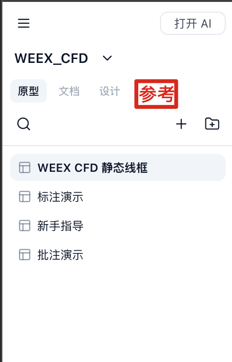

# REQ-011：参考页面与组件图文引入 PRD

日期：2026-11-06。
定位：下一个大版本的主需求。
状态：首版已实现，开发核验通过，待用户验收，尚未提交。分支：`codex/reference-component-prd`。
需求入口：[项目需求库](../docs/requirements/README.md)。

## 需求目标与当前命名

给软件增加一个“将 PRD 文档和组件截图结合起来”的模式。已确认复用现有批注能力，在 PRD 中增加组件说明，并融合对应组件的实际截图。

前置支持：通过链接或上传，将 Axure 发布的原型页面 HTML 缓存到项目中。在左侧“原型、文档、设计”后新增“参考”Tab；参考 HTML 页面也支持批注。

组件批注只有一个输入框。用户输入内容后，通过下一步动作决定用途：点击“AI 生成原型”，按输入要求生成或修改原型；点击“引入说明”，截取所选组件，并根据同一输入内容由 AI 整理补全图文，预览确认后写入 PRD。

按用户最新澄清，文档方向的动作名称为“引入说明”。前期使用的“引入文档”“引用文档”均指这一方向；“引入说明”不是第二个可选输入框。

## 已确认决策总览

| 决策 | 当前结论 | 确认依据 |
| --- | --- | --- |
| 参考入口 | 在“原型 / 文档 / 设计”后增加“参考”Tab，保存并预览项目内缓存页面 | 用户最初提出的主需求与示意图 |
| 导入途径与默认范围 | 支持链接、上传；链接默认当前页面，处理该页必要依赖 | 用户明确“默认当前页面即可” |
| 上传格式 | 首版支持 ZIP 和单个 HTML；ZIP 保留资源目录关系，单 HTML 用于依赖内嵌的页面，资源缺失时提示 | 用户选择“ZIP + 单个 HTML” |
| 批注交互 | 复用现有元素选择和批注，共用一个输入框，后续动作区分用途 | 用户明确“组件批注这个功能只有一个输入框” |
| 首版图文粒度 | 一次选中一个组件，为它生成一组图文 | 用户明确“先选中一个组件，然后为这个组件生成图文” |
| 输入与动作 | 同一批注内容用于“AI 生成原型”或“引入说明”；文档动作选择目标 PRD | 用户最新澄清，替代此前对可选独立“引入说明”字段的理解 |
| PRD 选择范围 | 首版仅选择当前项目中的 PRD | 用户选择“仅选择当前项目中的 PRD” |
| 图文写入位置 | 预览确认后的图文统一追加到目标 PRD 末尾，无需选择章节或插入位置 | 用户最新要求，替代此前章节选择方案 |
| 再次引入 | 同一组件再次生成图文时，也追加到 PRD 末尾，保留原内容，不提示选择更新或新增 | 用户明确更新图文直接追加到文末 |
| 生成与写入 | 用户手动触发生成，预览截图和说明，允许调整后确认写入 | 用户认可包含图文预览的操作流程 |
| 输出 | 实际组件截图、AI 整理补全的说明、来源关联，图文明确对应 | 用户原始目标及后续框架认可 |
| AI 补全边界 | 依据组件截图与批注整理说明；未提供的业务规则标记“待确认”，由用户补充 | 用户选择补全边界方案 1 |
| 空批注 | 允许批注为空时点击“引入说明”，根据组件可见内容生成基础说明，缺少的业务规则仍标记“待确认” | 用户选择空批注方案 1 |
| 多状态与长内容处理 | 用户先通过“AI 生成原型”将组件状态或长内容展开、平铺，再基于处理后的组件生成图文；当前不增加专门的状态采集或长图拼接流程 | 用户最新澄清，替代此前滚动截图及多状态采集方案 |
| 迭代顺序 | 先交付本需求，再做 REQ-012 的两类批注目录、暂存和单条/批量发送 | 用户明确提出后续小迭代 |

以上决策已确认，无需再次作为开放问题讨论。下文将未决定的产品规则与工程设计事项分别列出。

## 已确认的功能范围

### 11.1 “参考”资源入口与 Axure 页面导入

- 在现有“原型 / 文档 / 设计”之后增加“参考”Tab，位置按用户提供的示意图。
- 支持通过 Axure 发布页面链接，或者上传的方式引入页面。
- 上传首版支持 ZIP 和单个 HTML。ZIP 用于包含 HTML、CSS、JS、图片的页面资料，保留目录结构；单个 HTML 用于依赖已内嵌的页面，缺少资源时给出提示。
- 链接导入默认范围为当前页面。用户已明确选择“默认当前页面即可”，不默认导入整个 Axure 发布项目。当前页预览所需的静态 CSS、JS、图片等依赖纳入缓存，动态依赖限制见下方实施选择。
- 将页面 HTML 缓存、保存到当前项目，而非仅收藏一个外部链接。
- 用户可以在“参考”中打开并预览缓存的 HTML 页面。
- 链接默认范围与上传文件形态已确定；页面切换与缓存更新采用下方记录的首版实施选择。

### 11.2 在参考页面中选中组件并批注

- 参考 HTML 页面同样支持元素选择和批注，作为组件说明的来源。
- 普通原型页面也可使用后续的“引入说明”流程。
- 首版复用现有元素选择与批注，先选择一个组件，为该组件生成一组图文。一次引用对应一个选中组件，选中容器时组件范围可包含其内部内容，截图边界细节待实现时验证。
- 对多状态面板或长内容，用户可先要求“AI 生成原型”将其展开、平铺，再选择处理后的组件或容器生成一组图文。多个状态如何展示由原型处理结果表达，本次不另设逐状态采集流程。
- 组件批注只有一个内容输入框，输入后选择“AI 生成原型”或“引入说明”动作。前者用于原型生成/修改，后者用于组件截图和图文说明生成，不额外要求填写第二份引入说明。
- 单组件图文流程先交付；两类批注目录、暂存与批量发送作为后续小迭代，详见 [REQ-012](2026-11-06-批注目录与暂存批量执行.md)。

### 11.3 “引入说明”操作（首版）

1. 用户打开一个原型页面或参考页面。
   遇到多状态面板或长内容时，可先显式使用“AI 生成原型”将目标内容展开、平铺，再进行后续组件选择和图文生成。
2. 选择一个组件，在现有批注的唯一输入框中输入内容、使用已有批注，或留空直接引入说明。
3. 在所选组件的工具组中点击“引入说明”。同一输入内容也可供“AI 生成原型”动作使用，具体用途由点击的动作决定。
4. 从当前项目中选择待编辑的目标 PRD 文档，无需选择章节或插入位置。
5. 对当前选中组件进行截图，AI 根据同一份批注输入及组件信息整理、补全文字。已展开、平铺的内容以处理后的实际页面为依据；不增加独立的“引入说明”输入框。
6. 预览该组件的一组图文，用户可调整生成的说明或要求 AI 重新整理。
7. 用户确认写入，将本次截图和描述追加到选定 PRD 的末尾，并保留来源关联。再次生成也按同样方式追加。

已确认流程为“预览图文 → 确认 → 追加到 PRD 末尾”。不增加章节选择、自动合并、覆盖旧图文或重复引入决策流程。

### 11.4 PRD 中的最终结果

- PRD 包含所选组件的截图及对应的组件说明，图文应能明确对应。
- 说明以已有 comment 为基础，由 AI 整理、补全，而非单纯复制原始批注文字。
- AI 可依据截图中可见的组件信息和批注组织说明；输入未说明的业务规则统一列为“待确认”，由用户补充，不自行生成确定规则。
- 批注为空时也允许“引入说明”：采集组件截图，根据组件可见内容生成基础说明，缺少的业务规则继续列为“待确认”。此空输入规则针对文档动作，不改变现有原型生成动作的输入要求。
- 组件批注输入的内容可包含希望强调的功能、规则或表达方式。点击“引入说明”后，AI 使用这份内容整理、补全图文说明。
- 最终更新的是用户选择的 PRD 文档。
- 每次确认写入均在 PRD 末尾追加本次生成的图文，已有内容保留；同一组件的更新结果也按此处理。
- 文档中的组件截图指实际页面的组件采集结果；AI 负责整理说明，不用生成图片代替真实组件截图。
- 多状态和长内容先由用户通过原型生成动作展开、平铺，图文生成使用处理后的组件展示结果。REQ-011 当前不要求自动遍历状态、逐状态点击采集、滚动展开或拼接长图。
- 平铺是用户主动触发的原型处理动作；点击“引入说明”只对当前组件进行图文处理，不隐式修改原型来展开状态。

## 用户提供的入口示意

此图用于表达新 Tab 的名称和位置，不作为其它界面元素需要调整的要求。

## 建议实施拆分（技术计划）

1. **参考资源基础能力**：Tab、项目内资源列表、链接/上传导入、HTML 缓存和预览。
2. **参考页面批注能力**：复用单选、元素定位与批注，明确参考页面的保存方式。
3. **组件截图引入 PRD**：新增“引入说明”动作、目标 PRD 选择、共用批注输入、截图与文字配对、文末追加写入。
4. **AI 补全与迭代体验**：基于批注和组件信息生成说明，处理预览、调整及基础错误反馈；再次生成按同一追加流程处理。

首版已完成上述四部分；用户已确认后续通过 REQ-012 增加批注目录与批量发送。

## 首版实施选择

此前未定的导入细节，首版采用以下实现：ZIP 可填写入口路径，预览顶部可切换包内 HTML；链接只缓存当前页面及静态依赖，支持 Axure `start.html#p=...` 内容页识别。缓存变更通过重新导入完成，不自动同步源站；“打开来源”在新窗口浏览原始页面。动态生成且无法静态识别的依赖不保证缓存，缺失资源展示提示。

参考 HTML 在隔离环境中预览，批注经固定项目/页面的消息桥接保存。参考页的原型 AI 动作先在宿主窗口预览要求，由用户确认后执行；页面内容不能自行发起 AI 修改。普通原型的既有 AI 执行行为保持原有流程。

PRD 写入位置及重复引入规则已统一为文末追加，不再作为开放问题；不新增章节定位、合并更新、重复检测或专门的版本替换流程。文档格式兼容、基础保存反馈等结合现有文档编辑能力在实现设计中落实。

“是否复用批注”“默认导入哪一页”“一次生成几组图文”“是否先预览再写入”均已从待定问题中移出。多状态和长内容采用先平铺原型再生成图文的方式，当前不继续讨论专门采集能力。批注目录、暂存和批量发送已经移至 REQ-012。

## 文档与资源组织

- 每组内容采用组件标题、真实 PNG 截图、Markdown 说明和来源页面/组件名称/选择器的组织形式。
- 首版支持当前项目 `src/resources/` 内的 Markdown PRD；截图保存在 PRD 同级 `assets/component-<UUID>.png`，使用相对引用。复制或导出 PRD 时需携带同级 `assets/`。
- 文档写入在末尾追加新内容，保留已有正文；追加保存与来源信息结合现有文档编辑链路实现。
- 参考缓存保存在 `.axhub/make/references/<ID>/files/`；截图来自实际选中 DOM，AI 收到图片附件和同一批注内容，只读整理说明。初次流程不增加第二个说明输入框，生成后才显示重新生成要求。

## 与现有需求的关系

- REQ-001 至 REQ-005 提供元素选择、多选与批注交互基础。
- REQ-008 继续约束 AI 新增或修改界面的线框图风格；本需求中的源页面截图作为真实采集内容保留。
- REQ-009 的“选中范围”概念可供截图范围设计参考；截图和可编辑 Axure 结构导出是不同交付物。
- REQ-010 的手动输入要求与迭代经验可供交互设计参考。本需求采用图文预览后手动确认、文末追加写入的流程。

## 首版验收目标

以下复选框表示开发后是否完成验收，未勾选不表示上述产品方向尚未确认。

- [ ] “参考”Tab 位于“设计”之后，支持管理项目内参考页面。
- [ ] 链接及 ZIP / 单个 HTML 上传均可引入目标 Axure 页面，缓存页面可预览，资源缺失有提示。
- [ ] 参考页面支持选中组件并批注，普通原型页面也能进入“引入说明”。
- [ ] 组件批注只有一个输入框，可选择“AI 生成原型”或“引入说明”动作，不增加独立的可选说明字段。
- [ ] 文档动作可选择当前项目中的目标 PRD。
- [ ] 用户选择目标 PRD 后，确认的图文直接追加到文末，操作中没有章节或位置选择。
- [ ] “AI 生成原型”按输入要求生成/修改原型；“引入说明”对所选组件截图，并按同一输入内容整理、补全图文说明。
- [ ] 文档图文中的未提供业务规则标记“待确认”，不被 AI 写成确定规则。
- [ ] 批注为空时仍可点击“引入说明”，生成组件截图和基础说明，并标出待确认业务规则。
- [ ] 用户通过原型生成动作将状态或长内容展开、平铺后，可对处理后的组件或容器生成图文；文档动作不会隐式执行平铺或状态遍历。
- [ ] 单个选中组件生成一组图文，经预览确认后正确合入目标 PRD，保留来源关联。
- [ ] 同一组件再次生成图文时仍追加到文末，既有图文保留，不询问更新、替换或合并。
- [ ] 图片资源保存和文档追加保存有明确的成功或失败反馈。

## 下一步

按[实施计划](2026-11-06-REQ011-implementation.md)完成开发验证，再由用户验收实际 Axure 页面。REQ-012 的批注目录、暂存和批量发送继续后置。

开发核验记录与用户验收步骤见 [REQ-011 验证说明](../docs/requirements/REQ-011-validation.md)。45 个测试文件、541 项测试及构建通过；实际 AI 图文追加和宿主确认后的原型修改已在独立测试项目验证。上方验收目标保留给用户逐项确认，不代表用户已经验收。

## 产品决策记录

- 2026-11-06：用户确认“默认当前页面即可”。链接导入默认处理当前页面；整项目默认导入与额外页面选择界面不作为已确认要求。上传格式、跨页跳转及缓存更新策略继续待细化。
- 2026-11-06：逐项确认上传格式，用户选择“1：ZIP + 单个 HTML”，对应的资源目录保留、内嵌依赖页面及资源缺失提示一并记录为首版规则。
- 2026-11-06：逐项确认 PRD 选择范围，用户选择“1：仅选择当前项目中的 PRD”；外部 PRD 导入能力不纳入本次首版范围。
- 2026-11-06（已被后续澄清替代）：用户曾选择已有章节或文末新增小节；后续统一改为文末追加，不再保留章节选择。
- 2026-11-06：用户认可复用批注与“引用文档”框架，明确首版“先选中一个组件，然后为这个组件生成图文”，一次选择对应一组图文。后续另做小迭代，增加右侧批注目录及原型/文档两类批注的暂存与单条/批量发送，记录为 REQ-012。
- 2026-11-06：按用户要求复核确认状态，增加已确认决策与依据总览，统一当前动作名称，移除重复开放问题；保留尚未决定的产品规则，将资源存储及调用方式归入工程设计，区分“需求已确认”与“尚未开发验收”。
- 2026-11-06：用户纠正输入与动作模型：组件批注仅一个输入框，“AI 生成原型”和“引入说明”是后续动作，分别用于原型生成/修改、所选组件截图及图文补全。此决定覆盖前期“另填可选引入说明”的记录，移除额外字段和优先级问题，文档动作按最新用语统一为“引入说明”。
- 2026-11-06：用户选择 AI 补全边界方案 1：依据截图与输入整理说明；未说明的业务规则统一标记“待确认”，由用户补充，不由 AI 自行确立。
- 2026-11-06：用户选择空批注方案 1：允许批注为空时点击“引入说明”，依据组件可见内容生成基础说明，缺少的业务规则继续标记“待确认”。
- 2026-11-06（已被后续澄清替代）：用户曾选择截取全部滚动内容，以及一次收集组件多个状态。此处仅保留决策历史，不再作为首版专门采集能力的要求。
- 2026-11-06：用户明确多状态面板及长内容均可先要求“AI 生成原型”展开、平铺，然后根据处理后的内容重新生成图文，暂不需要解决专门的多状态采集和长截图问题。已更新功能范围、流程和验收项，并从待定问题中移除这两项。OK，可以开始这个需求的实现
- 2026-11-06：用户明确“更新的图文内容直接追加到 PRD 文档的末尾”，这些问题不用再操心。统一新生成和再次生成的写入策略为文末追加，保留旧内容；撤回章节选择，不增加合并更新、替换或重复引入提示，保留此前确认的图文预览流程。
